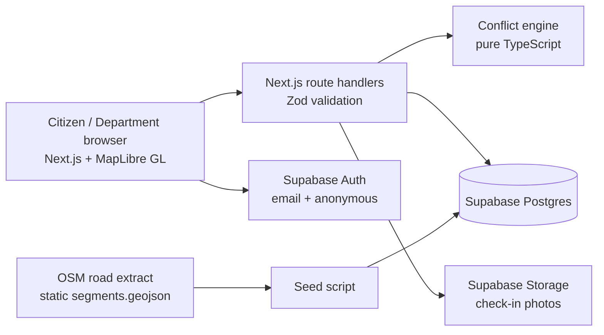

# DigOnce — Architecture

## System Overview

## Design Principles

1. **Engine isolation:** The conflict detection engine is a pure TypeScript module with no database access. Route handlers load works, call the engine, and return results. This makes it independently testable and explainable.

2. **Pre-extracted segments:** Road segments are extracted once from OpenStreetMap and shipped as a static GeoJSON file. Nothing calls Overpass at runtime.

3. **Server-side re-validation:** Conflicts are always re-checked server-side before saving. The client-side check is for UX feedback only — never trusted.

4. **Row Level Security:** Supabase RLS enforces data access at the database level, not just at the UI level.

5. **Deterministic decisions:** All conflict rules produce deterministic, explainable results. No AI/LLM in the decision path.

## Data Flow

### Conflict Check (Department creating work)
1. Department fills in work form (segments, dates, type)
2. Client debounces and calls `POST /api/conflicts/check`
3. Server fetches existing works on those segments from Supabase
4. Server calls `detectConflicts(candidate, existingWorks)`
5. Engine returns conflicts with rule IDs, severity, and explanations
6. Client renders conflict panel with accept/override options

### Citizen Check-in
1. Citizen navigates to work detail page
2. Clicks "Check in" → GPS or demo location picker
3. Client sends location to `POST /api/works/{id}/checkins`
4. Server computes distance to nearest segment point (Turf.js)
5. Check-in marked valid if ≤ 50m from segment
6. Returns verification status (≥3 distinct valid users = verified)

## Tech Stack

| Layer | Choice | Rationale |
|-------|--------|-----------|
| Framework | Next.js App Router + TypeScript | Single repo for UI and API |
| Hosting | Vercel Hobby | Free, auto-deploy, public URL |
| Database | Supabase (Postgres + RLS) | Free tier, auth included |
| Maps | MapLibre GL JS | Open source, no API key |
| Tiles | OpenFreeMap | Keyless free tiles |
| Geo math | Turf.js | nearestPointOnLine, distance |
| Validation | Zod | Shared schemas for API and forms |
| UI | Tailwind CSS | Fast, clean styling |
| Tests | Vitest | Engine unit tests |
| Road data | OpenStreetMap (via osmnx) | Real geometry, ODbL license |
